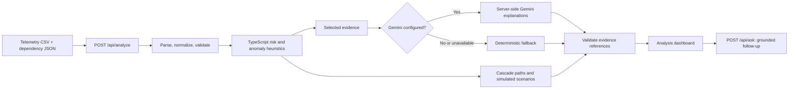

# SignalPath

**SignalPath is a hackathon prototype for investigating possible service failures from uploaded telemetry and dependency data.** It helps an operator identify suspicious signals, rank services by heuristic risk, inspect possible downstream impact, compare simulated recovery options, and ask evidence-grounded questions about the current analysis.

SignalPath starts with an empty workspace. It does not load an incident or run an analysis until the user supplies data and selects **Analyze**.

> **Prototype notice:** SignalPath is decision support, not a production monitoring or automated remediation system. Its risk scores and recovery figures are heuristic estimates, not calibrated probabilities or guarantees.

## What it does

- Accepts a telemetry CSV and a service-dependency JSON file.
- Validates and normalizes telemetry, then checks whether there is enough history to analyze.
- Uses TypeScript heuristics to identify metric anomalies, severe logs, and services with the strongest risk signals.
- Traces possible cascade paths through the submitted dependency graph.
- Optionally uses Gemini to classify symptoms and write engineering and executive explanations from selected evidence.
- Compares simulated recovery scenarios with a do-nothing baseline.
- Provides follow-up Q&A about the active analysis, with evidence references and uncertainty where available.
- Visualizes the story and uploaded graph with Three.js, provides a 2D/list alternative, and uses GSAP ScrollTrigger for story transitions.

The model does **not** calculate the risk score, traverse the graph, or execute a recovery action. Those responsibilities stay in the TypeScript application.

## How an analysis works



### Prediction and uncertainty

Risk scores rank services using the signals present in the uploaded data. They are not probabilities. Any displayed horizon is heuristic and should not be read as a statistically calibrated time-to-failure estimate. If the history is insufficient, the application returns an insufficient-data state instead of a forecast. Cascade paths describe possible impact based on the supplied dependency edges; they do not prove that an outage will occur.

### Recovery scenarios

Recovery options are simulated estimates intended to support comparison. They are not runbooks, commands, or verified operational capabilities. The uploaded files may not establish that a standby replica, backup pool, or particular mitigation is available. Do not use these estimates as a substitute for service-specific runbooks or operator judgment.

## Requirements

- Node.js 20 or newer
- npm
- A Gemini API key is optional. Without one, the deterministic fallback is used.

## Run locally

```bash
npm install
npm run dev
```

Open [http://localhost:3000](http://localhost:3000).

### Enable Gemini

1. Copy `.env.example` to `.env.local`.

   macOS/Linux/Git Bash:
   ```bash
   cp .env.example .env.local
   ```

   PowerShell:
   ```powershell
   Copy-Item .env.example .env.local
   ```

2. Add your API key to `.env.local`:

   ```env
   GEMINI_API_KEY=your_api_key_here
   ```

3. Restart the Next.js server.

Keep `.env.local` private. It is ignored by Git. Never use a `NEXT_PUBLIC_` variable for the key, commit it, or include it in screenshots or logs. The interface should indicate whether an explanation came from Gemini or the deterministic fallback.

## Input formats

### Telemetry CSV

Required columns:

```csv
timestamp,service,level,message
```

Optional numeric columns:

```csv
latency_ms,error_rate,cpu_pct
```

Example:

```csv
timestamp,service,level,message,latency_ms,error_rate,cpu_pct
2026-01-01T10:00:00Z,inventory-db,info,Query latency elevated,420,0.03,72.5
```

Headers are normalized to lowercase. Accepted levels are `debug`, `info`, `warn`, `error`, and `fatal` (common aliases such as `warning` and `critical` are also normalized). `error_rate` may be provided as a fraction from `0` to `1` or a percentage from `0` to `100`. `cpu_pct` must be between `0` and `100`.

Limits: telemetry files up to 5 MB and 5,000 rows; individual messages are bounded to 500 characters.

### Dependency JSON

```json
{
  "services": ["orders-service", "inventory-db"],
  "dependencies": [
    { "from": "orders-service", "to": "inventory-db" }
  ]
}
```

An edge means **`from` depends on `to`**. If `inventory-db` degrades, `orders-service` may be affected. The dependency file limit is 1 MB. References to unknown services are rejected.

Sample files are available in `public/sample-telemetry.csv`, `public/sample-dependencies.json`, and `public/insufficient-telemetry.csv`. The user must opt in to loading the demo files; they are not analyzed automatically.

## API overview

### `POST /api/analyze`

Accepts `multipart/form-data` with:

- `telemetry`: CSV file
- `dependencies`: JSON file
- `source`: optional `upload` or `sample` label

Returns a validated analysis, an explicit insufficient-data result, or a structured validation error. File limits are 5 MB for CSV and 1 MB for dependency JSON.

### `POST /api/ask`

Accepts a JSON question and bounded context for the active analysis. The answer may include verified evidence IDs, uncertainty, and safe investigation suggestions. It must not claim that infrastructure was changed or the incident was resolved.

The active analysis is not backed by a database. When Gemini is enabled, selected telemetry evidence and follow-up context are sent from the server to Google's Gemini API. Review the applicable Google API data-handling and retention terms before using confidential or production telemetry. Do not assume that provider-side processing is the same as local-only processing.

## Checks

```bash
npm run typecheck
npm run build
```

To run the API invariant checks, start the app in one terminal and run this in another:

```bash
node test-api.mjs
```

The API checks expect the local application to be reachable at `http://localhost:3000`.

## Project documentation

- [Product requirements](PRD.md)
- [Technical requirements](TRD.md)
- [Application flow](app-flow.md)
- [Backend schema](backend-schema.md)
- [Build plan](plan.md)
- [Technologies, AI, and contributions](TECHNOLOGIES_AND_CONTRIBUTIONS.md)

## Status

Built for **Orcathon — Track 1: Software & AI**. SignalPath is a prototype demonstrating telemetry validation, heuristic risk analysis, dependency-based cascade tracing, optional Gemini-assisted explanations, and simulated recovery comparisons. Validate all outputs against real operational context before acting on them.
